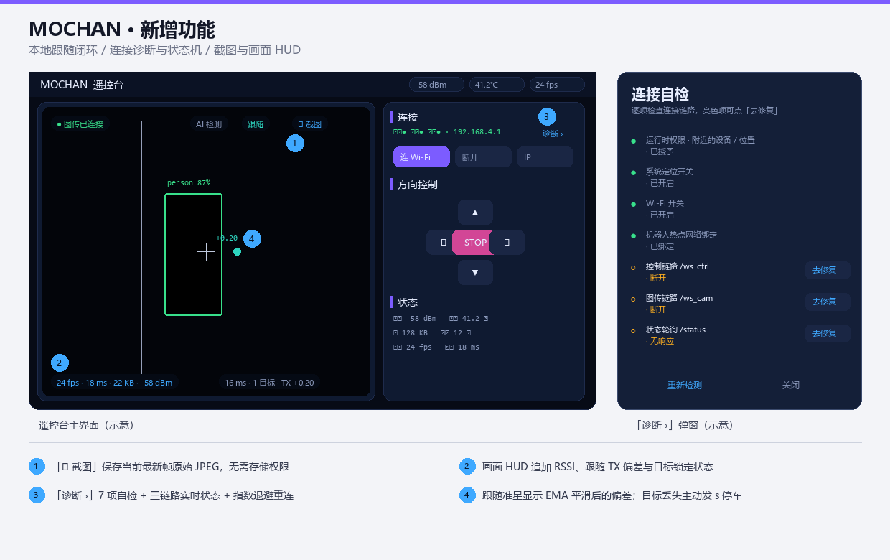
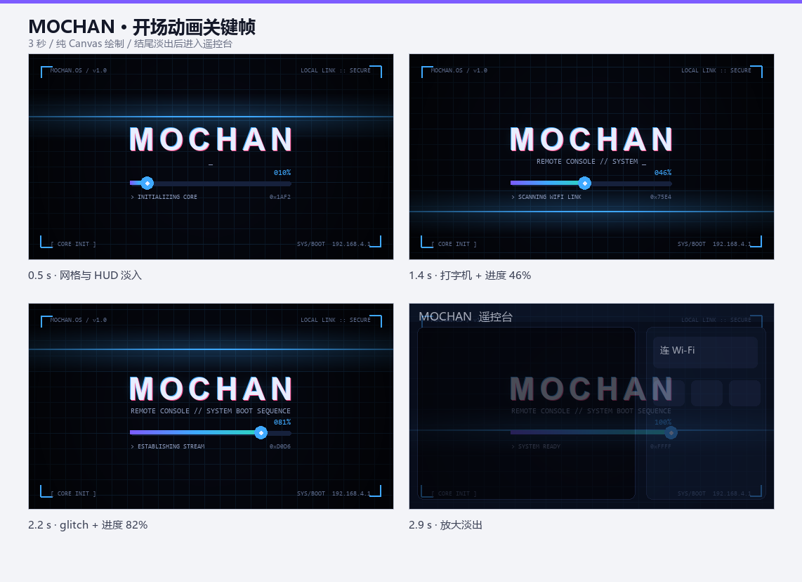
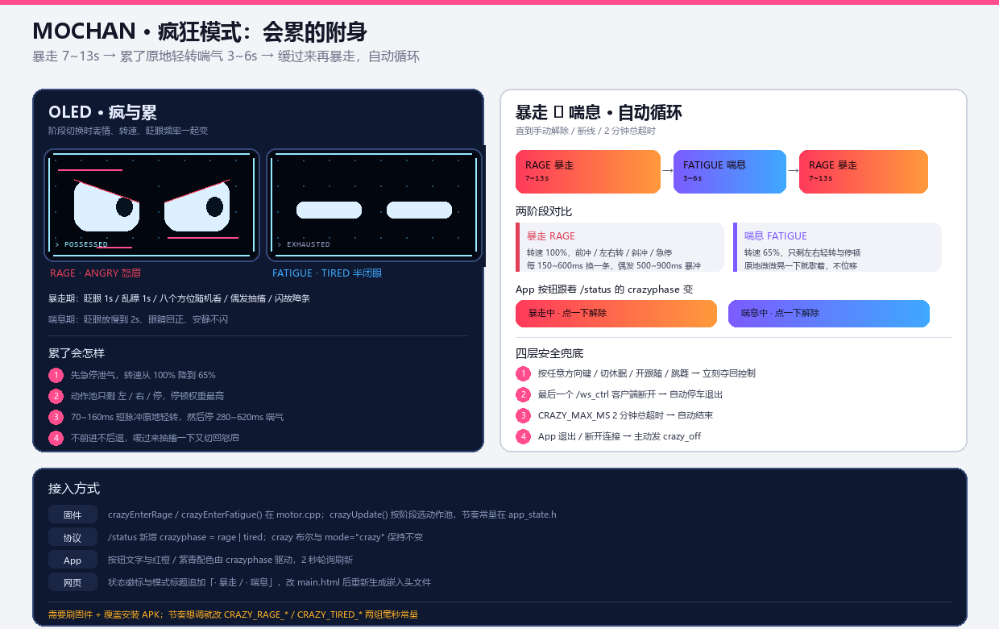
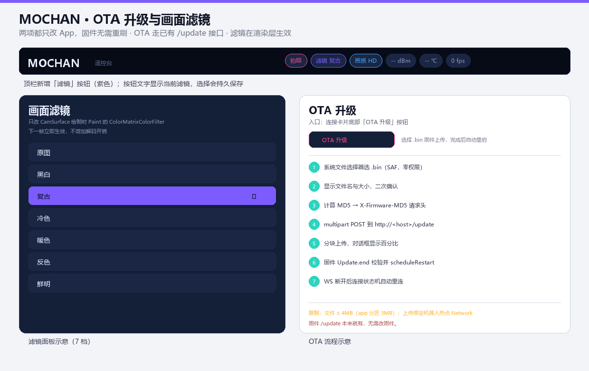
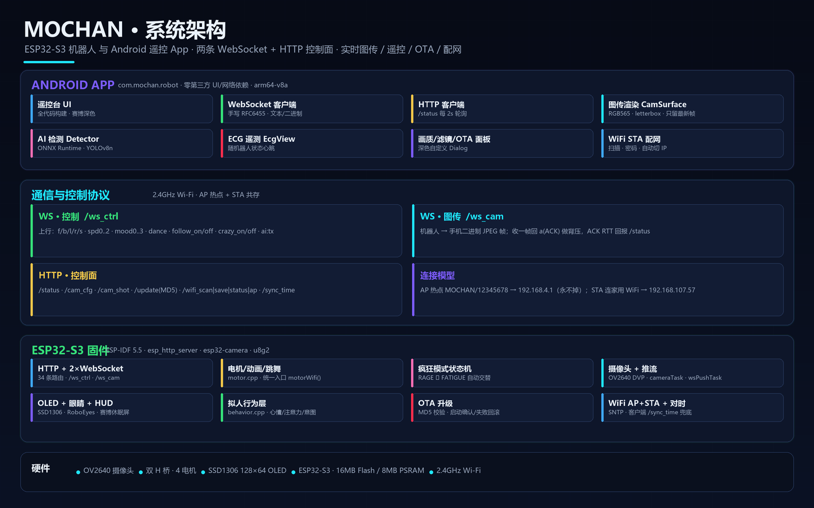
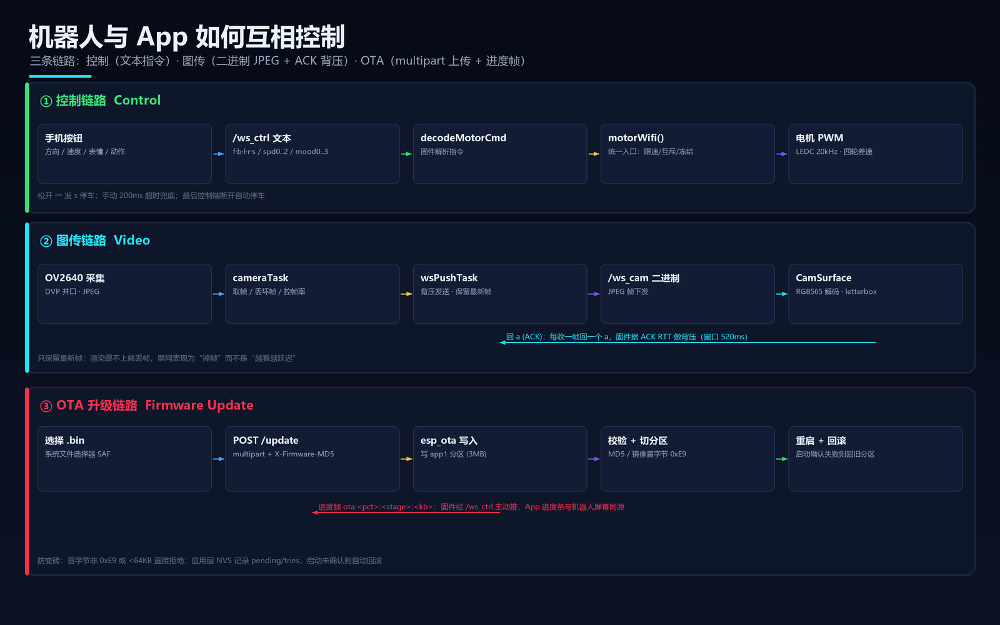
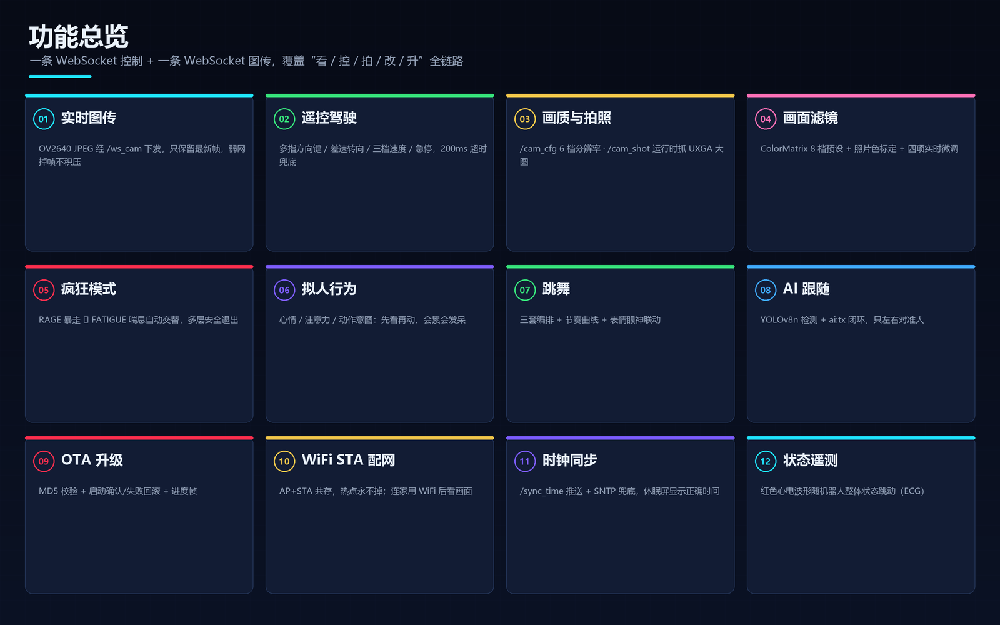

# MOCHAN · 赛博机器人 & 手机遥控台


> 一台会「看、走、拍、闹、累」的四轮桌面机器人：ESP32-S3 固件负责摄像头、电机、OLED 表情与所有实时控制，
> Android App 负责遥控台、实时图传、AI 跟人、OTA 与赛博风交互。
> 两者之间只有 **两条 WebSocket + 一套 HTTP 控制面**，协议简单、两端都能独立复现。


---

## 目录

- [这是什么](#这是什么)
- [效果预览](#效果预览)
- [系统架构](#系统架构)
- [机器人与 App 如何互相控制（核心）](#机器人与-app-如何互相控制核心)
  - [连接建立](#连接建立)
  - [① 控制指令 /ws_ctrl](#-控制指令-ws_ctrl)
  - [② 图传协议 /ws_cam](#-图传协议-ws_cam)
  - [③ 状态回报 /status](#-状态回报-status)
  - [HTTP 接口一览](#http-接口一览)
  - [OTA 升级链路](#ota-升级链路)
- [功能实现详解](#功能实现详解)
- [硬件与接线](#硬件与接线)
- [目录结构](#目录结构)
- [快速开始](#快速开始)
- [自己编译](#自己编译)
- [已下载产物（release/）](#已下载产物release)
- [已知限制](#已知限制)
- [致谢 / 第三方](#致谢--第三方)

---

## 这是什么

MOCHAN 是一个**桌面级四轮机器人 + 手机遥控 App** 的完整开源工程，包含两端：

| 端 | 位置 | 技术栈 | 说明 |
| --- | --- | --- | --- |
| 机器人固件 | [`1/MOCHAN`](1/MOCHAN) | ESP-IDF 5.5 / C++ | ESP32-S3，摄像头图传、电机、OLED 眼睛、WiFi、OTA、行为层 |
| Android App | [`3`](3) | 纯 Android 框架 + ONNX Runtime | 遥控台、图传渲染、AI 检测/跟随、OTA、滤镜、心电遥测 |
| 网页控制台 | [`1/MOCHAN/web_src`](1/MOCHAN/web_src) | 原生 HTML/JS | 固件内嵌页面，功能与 App 对齐（备用控制端） |

它的目标不是做一个玩具遥控车，而是把「一台有性格的小机器人」的**完整链路**跑通：
低延迟图传、多指差速遥控、拟人行为、疯狂模式、AI 跟人、画质/拍照、滤镜、OTA、AP/STA 配网、时钟同步，以及一条**随机器人整体状态跳动的心电波形**。

> 说明：`2/` 是一份早期的 Arduino 版本（功能等价），`1/MOCHAN` 是当前主线（ESP-IDF 原生实现）。

---

## 效果预览

**App 遥控台与连接自检**



**开机赛博动画**



<p>


</p>

---

## 系统架构



分层很清晰：

- **Android App**：遥控台 UI、手写 WebSocket 客户端、HTTP 客户端（`/status` 每 2s 轮询）、图传渲染 `CamSurface`、`ONNX Runtime` AI 检测、`EcgView` 心电遥测、画质/滤镜/OTA 面板、WiFi STA 配网。
- **通信与控制协议**：两条 WebSocket（文本控制 / 二进制图传）+ HTTP 控制面，跑在 2.4GHz Wi-Fi 上；AP 热点与 STA 局域网**共存**。
- **ESP32-S3 固件**：`esp_http_server`（30+ 路由）+ 2×WebSocket、电机/动画/跳舞/疯狂状态机、摄像头推流、OLED 眼睛与 HUD、拟人行为层、OTA、WiFi/SNTP。
- **硬件**：OV2640、双 H 桥四电机、SSD1306 OLED、ESP32-S3（16MB Flash / 8MB PSRAM）、2.4GHz Wi-Fi。

---

## 机器人与 App 如何互相控制（核心）



一句话概括：**手机发「文本指令」控制动作，机器人回「二进制帧」给画面、回「JSON」给状态；两条 WebSocket 各司其职，HTTP 负责配置与升级。**

### 连接建立

1. 机器人上电，起 AP 热点 `MOCHAN`（密码 `12345678`），地址 `http://192.168.4.1`；若已保存过家用 WiFi，则同时以 **AP+STA 共存**方式连上路由器（热点不会掉）。
2. App 启动即用 `WifiNetworkSpecifier` 搜索并连接该热点（手机已连则直接复用），把两条 WebSocket 与 `/status` 轮询**显式绑定到该 Network**，不依赖进程级 `bindProcessToNetwork`。
3. 建链后 App 同时打开：
   - `ws://<ip>/ws_ctrl` —— 文本，控制上行 + 进度/状态下行；
   - `ws://<ip>/ws_cam` —— 二进制，JPEG 视频下行。
4. 断线按 1.2s → 2.4 → 4.8 → 9.6s **指数退避**重连；`/status` 的存活时间戳用于判定「真在线」（断网/关机 6s 内 UI 与心电波形都会进入离线态）。

### ① 控制指令 `/ws_ctrl`

纯文本帧，一行一条；固件收到后进入 `decodeMotorCmd()`，最终**全部汇入 `motorWifi()` 这个统一入口**（限速、互斥、拍照冻结、断线停车都在这里生效）。

| 指令 | 作用 | 备注 |
| --- | --- | --- |
| `f` / `b` / `l` / `r` | 前 / 后 / 左 / 右 | 持续发送；200ms 无新指令自动停 |
| `s` | 立刻停车 | 固件 STOP 有快速路径，抢不到锁也强制断电 |
| `spd0` / `spd1` / `spd2` | 速度 慢65% / 中82% / 快100% | 也支持 `speed=N` |
| `mood0`~`mood3` | 表情 默认 / 疲惫 / 生气 / 开心 | |
| `mode_off` / `mode_soft` / `mode_normal` | 休眠 / 柔和 / 正常巡航 | 进入休眠切「赛博 HUD 休眠屏」 |
| `dance` | 跳舞 | 三套编排随机，约 3.5~3.8s |
| `follow_on` / `follow_off` | 开启/关闭跟随 | 只左右对准人，不前进后退 |
| `crazy_on` / `crazy_off` | 疯狂模式 开/关 | RAGE ↔ FATIGUE 自动交替 |
| `ai:tx:<v>` | 目标水平偏移 `-1.00..1.00` | 跟随时每 ≥200ms 上报一次 |
| `ai:person` | 「看到人」彩蛋 | ≤1 次/秒，触发开心表情 |

App 端把方向键做成**多指**：同时按住「前 + 左」即走左前，松开一个自动回到仍按住的方向，全松发 `s`。手动接管会立即打断跟随/疯狂。

### ② 图传协议 `/ws_cam`

- 固件 `cameraTask` 从 OV2640 取 JPEG 帧，`wsPushTask` 通过 `httpd_ws_send_frame_async` 直接写 socket 下发**二进制帧**（不阻塞主 HTTP 服务）。
- App `CamSurface` 收到帧后**先回一个文本 `a` 作为 ACK，再解码渲染**；固件据 ACK 往返做**背压**（窗口约 520ms），并把它记进 `/status` 的 `ackrtt`。
- App 渲染层**只保留最新帧**：WiFi 跟不上就丢帧，弱网表现为「掉帧」，而不是「越看越延迟」。解码用 `RGB_565` + `letterbox`，画完立即 `recycle()`。
- 兼容降级：`/stream` 会 302 到 **81 端口**上的独立 MJPEG 实例，主链路 `/ws_cam` 不受影响。

### ③ 状态回报 `/status`

App 每 2s 轮询一次，一次拿全所有状态（`org.json.JSONObject` 解析，字段增删不会静默失效）：

| 分组 | 字段 |
| --- | --- |
| 硬件 | `rssi` `temp` `heap` `minheap` `psram` `uptime` `fwver` |
| 运动 | `motor.name` `sleep` `speed` `speedpct` `speedduty` |
| 模式/情绪 | `mode` `mood` `moodstate` `crazy` `crazyphase` `crazyround` `crazyenergy` `crazyintensity` |
| 时钟 | `timesync` `tz` `clock` |
| 画质 | `camsize` `camfps` `camq` `cambad` `framebytes` `ackrtt` |
| 网络 | `wifimode` `ssid` `staip` `ip` `apstas` `wsctrl` `wscam` |
| OTA | `otapct` `otastage` `otakb` |

### HTTP 接口一览

固件共 30+ 条路由，常用如下（全部为 GET，除 `POST` 标注）：

| 路由 | 作用 |
| --- | --- |
| `/` `/ota` | 内嵌网页控制台 / OTA 页面（优先下发 gzip） |
| `/status` | 全量状态 JSON（见上表） |
| `/f` `/b` `/l` `/r` `/s` `/speed` `/spd0..2` | HTTP 版运动控制（网页端用） |
| `/mood` `/mode_off` `/mode_soft` `/mode_normal` `/dance` | 表情 / 模式 / 跳舞 |
| `/display_text` | OLED 显示文字（中英文自动选字体） |
| `/cam_cfg?size=&fps=&q=` | 推流画质：分辨率 `10..15`、帧率 `1..30`、JPEG 质量 `0..63` |
| `/cam_shot` | 运行时抓一张 UXGA 大图后恢复推流（<0.3s） |
| `/sync_time?timestamp=&tz=` | 客户端推送 UTC 时间 + 时区（分钟） |
| `/wifi_scan` `/wifi_save?ssid=&pwd=` `/wifi_status` `/wifi_ap` | 扫描 / 保存并连 STA / 查状态 / 回纯 AP |
| `/update`（POST） | OTA 上传固件（multipart + `X-Firmware-MD5`） |
| `/ai/*` `/ai_status` `/ai_upload`（POST） | AI 资源分发 / 状态 / 上传 |
| `/ws_ctrl` `/ws_cam` | 两条 WebSocket |

### OTA 升级链路

- App 用系统文件选择器（SAF）选 `.bin`（无需存储权限），`multipart/form-data` POST 到 `/update`，带 `X-Firmware-MD5`；可选 `X-OTA-Token`（NVS 配了才校验）。
- 固件防变砖三连：镜像首字节必须 `0xE9`、总大小 ≥64KB、MD5 校验；都过才写 `app1` 分区并切启动分区。
- **进度同源**：固件用同一个 `otaProgress()` 算百分比——OLED 升级屏、`/status` 的 `otapct`、以及 `/ws_ctrl` 主动推送的 `ota:<pct>:<stage>:<kb>` 帧**读的是同一个数**，所以手机进度条和机器人屏幕一致。
- **失败回滚**：NVS 记 `pending/tries`，启动未确认就自动切回旧分区重启（`sdkconfig` 没开 rollback 选项，用应用层实现）。

---

## 功能实现详解



### 实时图传
`OV2640 → cameraTask（取帧/丢坏帧/控帧率）→ wsPushTask（背压发送，保留最新帧）→ /ws_cam 二进制 → CamSurface（RGB565 解码 + letterbox）`。
配合 `TCP_NODELAY` 与 256KB 接收缓冲，默认 **HD 1280×720 / q20 / 25fps**。

### 遥控与急停
多指方向键 + 差速转向 + 三档速度；「STOP」走固件快速路径；双击画面或音量键急停（同时解除跟随/疯狂，避免自动驾驶抢电机）；手动 200ms 超时兜底，最后一个控制端断开自动停车。

### 画质与拍照
6 档分辨率（VGA→UXGA）/ 6 档帧率 / 4 档 JPEG 质量。**按分辨率限制最高画质**：UXGA/SXGA 只开放 q20/q30，HD 最高 q10，其余全档——App 面板动态过滤 + 固件 `clampQualityForSize()` 双保险。
`/cam_shot` 不发重新初始化，只运行时切到 UXGA+q1 抓一帧再恢复，正常 <0.3s。

### 画面滤镜与照片色
`CamSurface` 渲染时套 `ColorMatrixColorFilter`：8 档预设（原图/黑白/复古/冷/暖/反色/鲜明/**照片色**）+ 对比度/亮度/饱和度/色温四项实时微调；照片色用实拍样本拟合标定（对比度 0.6023 / 亮度 −25.37 / 饱和度 1.8556 / 色温 +3.0）。拍照/截图会套用同一矩阵，**相册颜色与屏幕一致**。

### 疯狂模式
`crazy_on` 后进入状态机：`RAGE`（暴走 7~13s，转速 100%、怒眉、随机前冲/斜冲/急停、OLED 闪故障条）↔ `FATIGUE`（喘息 3~6s，降到 65%、半闭眼、只原地轻晃），直到退出或 `CRAZY_MAX_MS`（2 分钟）超时。方向键/休眠/跟随/跳舞/断线都会自动打断，退出逐项恢复原状态。

### 拟人行为层
`behavior.cpp` 接管「巡航/柔和」：心情（平静/好奇/开心/无聊/犯困）联动表情与眨眼，**动作前先把眼睛转向方位**，动作从「定时抽奖重复 N 步」改成「走一小段 → 停下张望 → 再决定」的一次性意图。优先级低于休眠/手动/跟随/疯狂/跳舞/拍照冻结，不会抢控制权。

### 跳舞
固件三套编排（摇摆 Groove / 旋转 Spin / 恰恰 Cha），每次随机换一套且不连抽；有节奏曲线（起势→渐快→放慢定格）、对称/连转/点地，并联动笑眼、开心脸、眼神跟转、结尾鞠躬定格。统一 `danceStop()` 恢复跳舞前的表情/眨眼/巡航状态。

### AI 检测与跟随
App 端 `ONNX Runtime` 跑 **YOLOv8n**（320×320，`[1,84,2100]`，阈值 0.45、按类 NMS IoU 0.45、最多 20 个），模型从机器人 `/ai/yolov8n.onnx` 下载（gzip，仅下一次）。
**跟随只左右对准人**：App 把最大目标的水平偏移按 0.1 量化为 `ai:tx:-1.00..1.00` 上报，转向全交固件 `followMode`（EMA 0.35 + 死区 0.28 + 50~140ms 小步脉冲 + 350ms 冷却）——避免 App 自己发方向导致大步长来回甩。目标丢失按最后方向最多搜索 2.5s。

### WiFi AP / STA 配网
机器人**同时**开热点 `MOCHAN` 与连接家用 WiFi（AP+STA）：密码填错/路由器太远也不会失联。App 的 STA 面板：扫描机器人看到的 WiFi → 输密码 → 连接重启 → 轮询状态拿到 STA IP（本项目固定使用 `192.168.107.57`，可在 App 改）→ 手机切到同一 WiFi 即可看画面；「恢复 AP」随时回退。

### 时钟同步
ESP32 无 RTC、AP 直连无外网。App 在建链/恢复/每 5 分钟/`/status` 报 `timesync:false` 时推 `/sync_time?timestamp=&tz=`（时区取手机实际偏移，不写死 +8）；STA 模式另有 SNTP 兜底。未同步时休眠屏显示 `--:--` 与 `> NO CLOCK`。

### 状态遥测（ECG 心电）
画面右下角一条**红色霓虹心电波形**（`EcgView`），按机器人**整体状态**驱动：未连接=平线、待机~60、移动/跟随~96、跳舞~124（带律动）、疯狂~168（大振幅）、OTA~190（密集）；带逐拍 HRV、基线呼吸漂移、辉光随 R 波脉冲，高温/弱信号加抖，AP 模式不显示假信号。

### 赛博 UI
开机动画（网格/扫描线/glitch 标题/进度条/HUD 角标）、休眠屏（切角边框/刻度/信号格/扫描光带/`MOCHAN//OS` 字标/大号时钟）、OLED 眼睛（RoboEyes 模板 + 心情驱动）。App 端全代码构建深色 UI，零第三方 UI 库。

---

## 硬件与接线

| 项目 | 值 |
| --- | --- |
| 芯片 | ESP32-S3（QFN56），8MB OPI PSRAM，240MHz |
| Flash | 16MB，`dio` @ 80MHz |
| OLED | SSD1306 128×64，I²C `SDA=40 SCL=41` @ 400kHz |
| 摄像头 | OV2640 DVP：`XCLK15 SIOD4 SIOC5 VSYNC6 HREF7 PCLK13`，`Y9..Y2 = 16 17 18 12 10 8 9 11` |
| 电机 | `LF=14 LB=21 RF=42 RB=1`，LEDC 20kHz / 8bit，通道 4–7（双 H 桥） |

分区表（16MB）：`nvs 0x9000 / otadata 0xD000 / app0 0x10000(3MB) / app1 0x310000(3MB) / ffat 0x610000(~9.9MB，AI 资源)`。

---

## 目录结构

```
MOCHAN/
├── 1/MOCHAN/                # 机器人固件（ESP-IDF）
│   ├── main/                #   app_main / web / motor / camera / net / ui / behavior ...
│   ├── components/          #   esp32-camera, u8g2（含文泉驿字体）
│   ├── web_src/             #   网页控制台源码（embed_web.py 生成内嵌头文件）
│   ├── ai_assets/           #   打进 ffat 的 ONNX Runtime Web + YOLOv8n
│   └── partitions.csv
├── 3/                       # Android App
│   ├── src/com/mochan/robot/  # MainActivity / CamSurface / WsClient / Detector / DetectOverlay / EcgView / Ui / IntroView
│   ├── res/                 #   图标与资源
│   └── build_apk.sh         #   无 Gradle 打包脚本
├── docs/
│   ├── images/              #   README 配图
│   └── make_images.py       #   配图生成脚本（可复现）
├── release/                 # 已构建产物（bin + apk + SHA256SUMS）
└── tools/, idf.sh           # 构建辅助
```

---

## 快速开始

### 1. 烧写固件

```bash
# 标准 ESP-IDF 环境
. $IDF_PATH/export.sh
cd 1/MOCHAN && idf.py set-target esp32s3 && idf.py build && idf.py -p COM3 flash monitor
```

或直接用仓库根目录的 `idf.sh`（自动找本机 IDF 与 python env）：

```bash
cd 1/MOCHAN && ../../idf.sh -p COM3 flash monitor
```

`idf.py flash` 会自动把 AI 资源一起烧进 `ffat` 分区；只更新固件用 `idf.py app-flash`。

### 2. 安装 App

```bash
adb install -r release/MOCHAN-remote.apk
```

或把 APK 拷到手机点开安装（首次需允许「未知来源」）。

### 3. 首次使用

1. 机器人上电，等 OLED 播完开机动画、开好热点 `MOCHAN`。
2. 打开 App（约 3 秒赛博开场动画，连接并行启动）；按提示允许「附近的设备 / 位置信息」权限，App 自动连热点。
3. 看到画面后即可方向键遥控、点「画质 / 拍照 / 滤镜 / 跳舞 / 疯狂 / AI 跟随」。
4. 想让机器人连家里 WiFi：点连接卡片的 **STA**，扫描 → 选网络 → 输密码 → 连接；成功后把手机切到同一 WiFi 即可。
5. 升级固件：状态卡片「OTA 升级」选 `release/MOCHAN.bin`，进度条与机器人屏幕同步。

> 各子系统的更细说明见 [`3/README.md`](3/README.md) 与 [`1/MOCHAN/README.md`](1/MOCHAN/README.md)。

---

## 自己编译

**固件**：`cd 1/MOCHAN && idf.py build`（目标 `esp32s3`，配置见 `sdkconfig.defaults`）。改网页后先 `python tools/embed_web.py` 重新生成 `web_content*.h`。

**App**：无需 Android Studio / Gradle：

```bash
bash 3/build_apk.sh
```

脚本用 SDK 自带 `aapt2 + d8 + zipalign + apksigner` 手工打包，首次会生成调试签名 `3/debug.keystore`（口令 `android`），产物在 `3/MOCHAN-remote.apk`。

**配图**（可选）：`python docs/make_images.py` 重新生成 `docs/images/architecture.png` 等。

---

## 已下载产物（release/）

| 文件 | 大小 | 说明 |
| --- | --- | --- |
| [`release/MOCHAN.bin`](release/MOCHAN.bin) | 1.42 MB | 机器人固件（OTA / `idf.py flash` 均可） |
| [`release/MOCHAN-remote.apk`](release/MOCHAN-remote.apk) | 6.5 MB | Android App（`1.0.20261109-1451`） |
| [`release/SHA256SUMS.txt`](release/SHA256SUMS.txt) | — | 校验值，`sha256sum -c SHA256SUMS.txt` |

> 固件与 App 建议配套更新；仅装新 APK 时，依赖新固件的功能（如 `/cam_cfg`、`crazy_*`、OTA 进度推送）会自动降级或保持只读。

---

## 已知限制

- 固件参数（电机方向、摄像头引脚、OLED 地址）需按你的实际硬件核对；本项目主要在作者自己的板子上验证。
- 图传默认 HD；XGA 以上做**推流**单帧易超 192KB 共享缓冲，建议只用于拍照。
- App 只带 `arm64-v8a` 的 ONNX Runtime（省体积），32 位老机型可装但开 AI 会报错；跟随只跟画面中最大的人、只左右转。
- AI 推理在**手机**上跑（ONNX Runtime Web/WASM 在网页端），固件只负责分发模型与执行跟随转向。
- AP 热点密码固定 `12345678`；OTA 口令默认关闭（NVS `ota/token` 为空时）。

---

## 致谢 / 第三方

- [esp32-camera](https://github.com/espressif/esp32-camera)（Espressif 官方摄像头组件）
- [u8g2](https://github.com/olikraus/u8g2)（含文泉驿 GB2312 12px 字体）
- [RoboEyes](https://github.com/FluxGarage/RoboEyes)（机器人眼睛动画，已模板化移植）
- [ONNX Runtime](https://onnxruntime.ai/) + YOLOv8n（AI 检测）
- ESP-IDF 5.5 · Android SDK

> 本项目为个人学习/创作项目，硬件与固件参数请自行核对后再通电。欢迎 Issue / PR。
